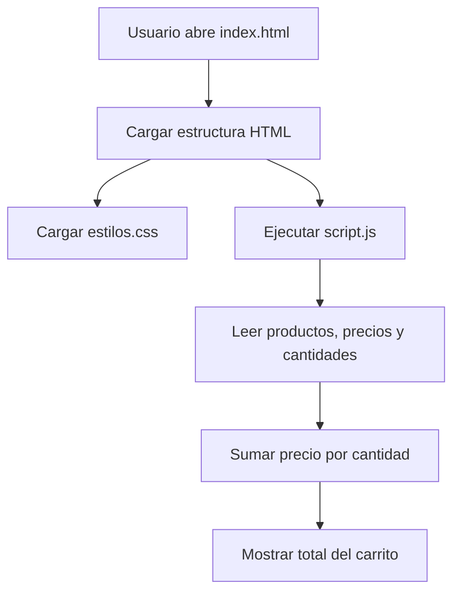

# lab05


# Laboratorio 3: Trabajo colaborativo con repositorios remotos

## Descripción

Tienda TECSUP es una página web de práctica que muestra productos y calcula el total de un carrito de compras.
Está desarrollada con HTML, CSS y JavaScript para el Laboratorio 3 del curso Diseño de Interfaces de Programación Avanzado.
Está dirigida a estudiantes que practican Git y GitHub mediante Issues, ramas y Pull Requests.

## Tabla de contenidos

- [Descripción](#descripción)
- [Objetivos](#objetivos)
- [Conceptos principales](#conceptos-principales)
- [Errores que se trabajan](#errores-que-se-trabajan)
  - [El total del carrito no considera las cantidades](#1-el-total-del-carrito-no-considera-las-cantidades)
  - [La hoja de estilos no se carga](#2-la-hoja-de-estilos-no-se-carga)
- [Instalación](#instalación)
- [Uso](#uso)
- [Tabla de archivos](#tabla-de-archivos)
- [Flujo principal](#flujo-principal)
- [Hoja de ruta](#hoja-de-ruta)
- [Flujo de trabajo](#flujo-de-trabajo)
- [Comprobaciones y entregables](#comprobaciones-y-entregables)
- [Contribución](#contribución)
- [Comandos útiles](#comandos-útiles)
- [Repositorio de práctica](#repositorio-de-práctica)

## Objetivos

- Explicar la diferencia entre un repositorio remoto, un fork y un clon.
- Crear un fork del repositorio de práctica y clonarlo localmente.
- Reportar errores con Issues claros y reproducibles.
- Corregir los errores en ramas propias y proponer los cambios con Pull Requests.
- Mantener actualizado el fork y la copia local.

## Conceptos principales

| Término | Significado |
|---|---|
| Fork | Copia del repositorio original en una cuenta de GitHub. |
| Clone | Copia local del repositorio, descargada con `git clone`. |
| Issue | Reporte de un error o tarea pendiente en el repositorio original. |
| Pull Request (PR) | Propuesta para que el responsable revise e integre cambios. |
| `origin` | Nombre habitual del remoto del que se clonó el proyecto; en este ejercicio, el fork propio. |

## Errores que se trabajan

### 1. El total del carrito no considera las cantidades

La función `calcularTotal` suma el precio una vez por producto, aunque haya varias unidades. El cálculo debe multiplicar el precio por la cantidad:

```js
 total = total + producto.precio * producto.cantidad;
```

Con dos polos de S/ 25.00 y una taza de S/ 18.00, el total esperado es **S/ 68.00** (en lugar de S/ 43.00).

### 2. La hoja de estilos no se carga

La página aparece sin los colores ni la tipografía del proyecto. Se debe comparar el nombre real de `estilos.css` con la ruta indicada en el atributo `href` del archivo `index.html` y corregir la referencia para que coincidan.

## Instalación

Requisitos: Git, un navegador web y acceso al repositorio de práctica. Clona tu fork y entra en la carpeta del proyecto:

```bash
git clone https://github.com/TU-USUARIO/tienda-tecsup.git
cd tienda-tecsup
```

## Uso

Abre `index.html` en un navegador. También puedes iniciar un servidor local sencillo con Python desde la carpeta del proyecto:

```python
from http.server import HTTPServer, SimpleHTTPRequestHandler

servidor = HTTPServer(("localhost", 8000), SimpleHTTPRequestHandler)
print("Abre http://localhost:8000 en el navegador")
servidor.serve_forever()
```

La página debe mostrar los productos con sus estilos y calcular un total de **S/ 68.00**. El ejemplo de servidor requiere Python 3 y se detiene con `Ctrl+C`.

## Tabla de archivos

| Archivo     | Propósito                                      | Tecnología |
|:------------|:----------------------------------------------|:----------:|
| `index.html`| Estructura de la página y carrito              | HTML       |
| `estilos.css`| Colores, tipografía y presentación             | CSS        |
| `script.js` | Cálculo del total y comportamiento             | JavaScript |

## Flujo principal

El navegador carga la página, aplica los estilos y ejecuta el script que calcula el total del carrito según el precio y la cantidad de cada producto.


## Hoja de ruta

- [ ] Corregir el cálculo del total para considerar la cantidad de cada producto.
- [ ] Corregir la referencia a la hoja de estilos en `index.html`.
- [ ] Crear un Issue claro por cada error encontrado.
- [ ] Implementar cada corrección en una rama creada desde `main`.
- [ ] Crear al menos dos commits con mensajes descriptivos y publicar ambos en el fork mediante `git push`.
- [ ] Abrir un Pull Request por corrección y revisar que cambie un solo archivo.
- [ ] Sincronizar el fork y la copia local con el repositorio original.
## Flujo de trabajo

1. Abrir el repositorio de práctica compartido por el docente y revisar el código y el README del proyecto.
2. Crear un fork en la cuenta personal de GitHub.
3. Clonar el fork y comprobar el remoto:

   ```bash
   git clone https://github.com/TU-USUARIO/tienda-tecsup.git
   cd tienda-tecsup
   git remote -v
   ```

4. Reproducir el error y documentarlo en un Issue del repositorio original, indicando qué se esperaba, qué ocurre, dónde ocurre y cómo reproducirlo.
5. Volver a `main`, actualizarla y crear una rama descriptiva para cada corrección:

   ```bash
   git switch main
   git pull
   git checkout -b fix-total-carrito
   ```

6. Modificar y probar la corrección. Revisar el cambio antes de registrarlo:

   ```bash
   git diff
   git add script.js
   git commit -m "Corrige el calculo del total del carrito"
   git push origin fix-total-carrito
   ```

7. Abrir un Pull Request desde la rama del fork hacia `main` del repositorio original. Incluir el número del Issue y revisar que `Files changed` muestre únicamente el archivo esperado.
8. Repetir el ciclo para el segundo error, creando la nueva rama desde `main` para que el PR contenga solo esa corrección.
9. Sincronizar el fork con el repositorio original y luego actualizar la copia local con `git pull`.

> Sustituye `TU-USUARIO` por el nombre de usuario real de GitHub. El nombre de rama, el mensaje del commit y la descripción del PR pueden ajustarse al Issue correspondiente.

## Comprobaciones y entregables

- Dos Issues publicados en el repositorio original, con títulos claros y pasos para reproducir los errores.
- Dos ramas de corrección creadas desde `main`, cada una con su propio commit.
- Al menos dos commits con mensajes descriptivos, ambos publicados en el fork con `git push`.
- Dos Pull Requests abiertos hacia el repositorio original, vinculados a sus Issues.
- Cada Pull Request muestra un solo archivo modificado en `Files changed`.
- Fork y carpeta local sincronizados con el repositorio original.
- Capturas del código corregido y de su ejecución.

## Contribución

Las contribuciones se reciben mediante Issues y Pull Requests. Antes de proponer un cambio, revisa las pautas de [CONTRIBUTING.md](CONTRIBUTING.md).
## Comandos útiles

```bash
git status
git branch
git log --oneline
git diff
git remote -v
git switch main
git pull
```

## Repositorio de práctica

[tienda-tecsup](https://github.com/jeisson-tecsup/tienda-tecsup)


